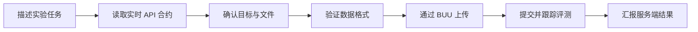

<p align="center">
  <picture>
    <source media="(prefers-color-scheme: dark)" srcset="./assets/coderland-logo-dark.svg">
    <source media="(prefers-color-scheme: light)" srcset="./assets/coderland-logo-light.svg">
    
  </picture>
</p>

<h1 align="center">码境实验 Agent Skill</h1>

<p align="center">让 Codex 用自然语言协助你浏览实验、整理数据集、提交复现并查看评测结果。</p>

<p align="center">
  
  
  
  
</p>

## 🚀 一句话安装

把这句话发给 Codex，它会从本仓库安装 Skill；如果本机还没有 API Key，也会引导你生成并安全配置：

```text
请用 skill-installer 从 https://github.com/littlezuicat/coderland-experiment-skill 安装码境实验 Skill；如果我还没有 API Key，请引导我打开 https://code.zuicat.cn/profile/?tab=settings 生成，然后通过本机隐藏输入配置，不要让我把密钥发到对话里。
```

安装完成后，Codex 可按 Skill 说明处理后续的码境实验任务。

## 它能做什么

这个 Skill 为 Codex 提供一套码境实验空间的操作说明，并附带一个仅依赖 Python 标准库的辅助脚本。它会先读取服务端当前 API 合约和数据集规范，再按用户选定的目标执行操作。

| 场景 | 能力 |
| --- | --- |
| 浏览实验空间 | 查看数据集、论文、复现记录和评测信息 |
| 准备数据集 | 检查目录或 ZIP，按服务端规范验证并打包 |
| 上传文件 | 通过 BUU 上传通道分块、断点续传 |
| 提交复现 | 关联数据集与论文，上传结果文件并跟踪评测状态 |
| 查看结果 | 汇报服务端返回的指标、图片数量、预览和警告 |
| 管理本人记录 | 按支持的 API 修改本人复现记录的公开状态或删除记录 |



## 支持的数据集格式

Skill 会读取实时上传规范；下表帮助你快速了解常见结构。实际类别、文件类型和限制以服务端返回为准。

| 类型 | 常见 ZIP 结构 | 关键校验 |
| --- | --- | --- |
| 有参考图像复原 | `input/` + `gt/` | 输入与真值按相对路径配对 |
| 无参考图像复原 | `input/` | 至少包含一张输入图像 |
| 图像分割 | `input/` + `gt/` | 图像与掩码按文件名对应 |
| COCO 目标检测 | `input/` + `annotations/instances_*.json` | 校验图片、类别、标注引用 |
| COCO 人体关键点 | `input/` + `annotations/person_keypoints_*.json` | 校验图片、类别和关键点字段 |

对 COCO 任务，预测结果按当前接口要求上传 `predictions.json`；官方指标由码境服务端计算。Skill 不会自行编造或替代官方分数。

## 在 Codex 中安装

在 Codex 对话里发送上面的「一句话安装」提示词即可。若 API Key 尚未生成或本机还没有配置，按提示前往[码境账号设置](https://code.zuicat.cn/profile/?tab=settings)生成，再通过本机隐藏输入完成配置；不要把密钥发进聊天。

安装后重启或刷新 Codex 的 Skill 发现。安装目录通常是 `~/.codex/skills/coderland-experiment`。你也可以直接打开 [Skill 说明](coderland-experiment/SKILL.md) 查看完整操作规则。

### 手动安装

把 [`coderland-experiment/`](coderland-experiment/) 目录完整复制到 Codex 的 Skill 目录，确保其中保留 `SKILL.md` 和 `scripts/`：

```bash
mkdir -p ~/.codex/skills/coderland-experiment
cp -R coderland-experiment/. ~/.codex/skills/coderland-experiment/
```

## 首次使用

1. 如果还没有 API Key，登录码境并打开[个人中心 → 账号设置](https://code.zuicat.cn/profile/?tab=settings)生成。完整密钥只显示一次。
2. 在终端运行辅助脚本的 `configure` 命令，并在隐藏输入提示中粘贴密钥；不要把密钥发到对话里。
3. 运行 `contract` 获取当前 API 规则与上传规范。
4. 后续可让 Codex 直接处理任务，例如：“检查我选中的数据集 ZIP 是否符合 COCO 目标检测格式。”

Linux/macOS 示例：

```bash
python3 ~/.codex/skills/coderland-experiment/scripts/coderland.py configure
python3 ~/.codex/skills/coderland-experiment/scripts/coderland.py contract
```

密钥保存在系统配置目录的 `coderland/credentials.json` 中，并尽可能限制文件权限。脚本只保存 API Key，不保存账号密码。运行 `forget` 可清除本机保存的密钥；如需使密钥失效，请在码境账号设置中撤销。

## 常用命令

```bash
SKILL=~/.codex/skills/coderland-experiment/scripts/coderland.py

python3 "$SKILL" --help
python3 "$SKILL" contract
python3 "$SKILL" api GET /api/v1/experiments
python3 "$SKILL" inspect --profile coco-detection --source ./dataset.zip
python3 "$SKILL" package --profile paired-restoration --source ./dataset-folder
python3 "$SKILL" add-paper --dataset-id selected-dataset --query "Paper title" --network-name "Method name"
```

新生成的 ZIP 放在当前项目的 `coderland-output/` 目录。脚本尽量保留图片和权重原始字节；只有实时规范允许时才会调整 ZIP 内的路径，以及 COCO JSON 中相应的 `file_name`。

`add-paper` 会显示候选论文并要求选择序号，候选令牌不会打印出来。可加 `--pdf PATH` 一并上传论文 PDF；为已有论文补传 PDF 使用 `upload-paper-pdf --paper-id ID --dataset-id ID --pdf PATH`。PDF 必须通过文件签名检查且不超过 50 MiB。复现评测使用 `finalize --staging-id ID --dataset-id ID`；请求超时后辅助脚本只读核对暂存和数据集目录，不会重复提交。

`api METHOD PATH --output FILE` 会将二进制响应按块直接写入目标文件；传输中显示进度，成功后才替换已有目标，失败时会保留原文件并清理临时文件。未知总大小时仍会显示已接收字节。

## 安全与边界

- 只操作用户明确选定的数据集、论文、记录和文件，不按文件名或“最近记录”猜目标。
- 只处理当前 API Key 所属账号的数据；公开状态仅作用于本人支持的复现记录。
- API Key、BUU 临时票据、可续传 URL 和研究文件都是私密信息，不应进入公开仓库、命令参数、日志或聊天内容。
- 删除是永久操作；必须先说明目标和影响，并在删除请求前取得用户明确确认。不会删除数据集。
- 上传前检查 BUU 通道是否可用。不可用时停止，不绕到浏览器会话接口或公网线路上传。
- 服务端返回 `410` 或 `FEATURE_DISABLED` 时，表示 API 暂不可用；停止操作，不绕过限制。
- 只支持文档化的 `/api/v1/experiments` 成员 API，不执行管理操作。

## 仓库内容

```text
.
├── README.md
├── assets/
│   ├── coderland-logo-dark.svg
│   └── coderland-logo-light.svg
├── coderland-experiment/
│   ├── SKILL.md
│   └── scripts/
│       └── coderland.py
└── tests/
    └── test_coderland.py
```

## 反馈

如果安装路径、接口规则或数据集格式发生变化，欢迎通过 [GitHub Issues](https://github.com/littlezuicat/coderland-experiment-skill/issues) 提交问题。实际请求参数和限制始终以码境服务端最新 API 合约为准。
